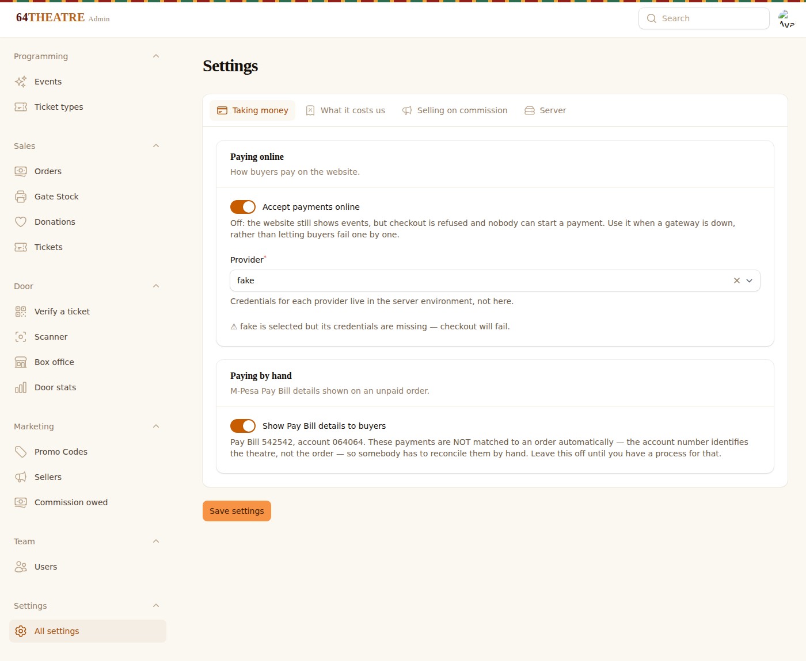
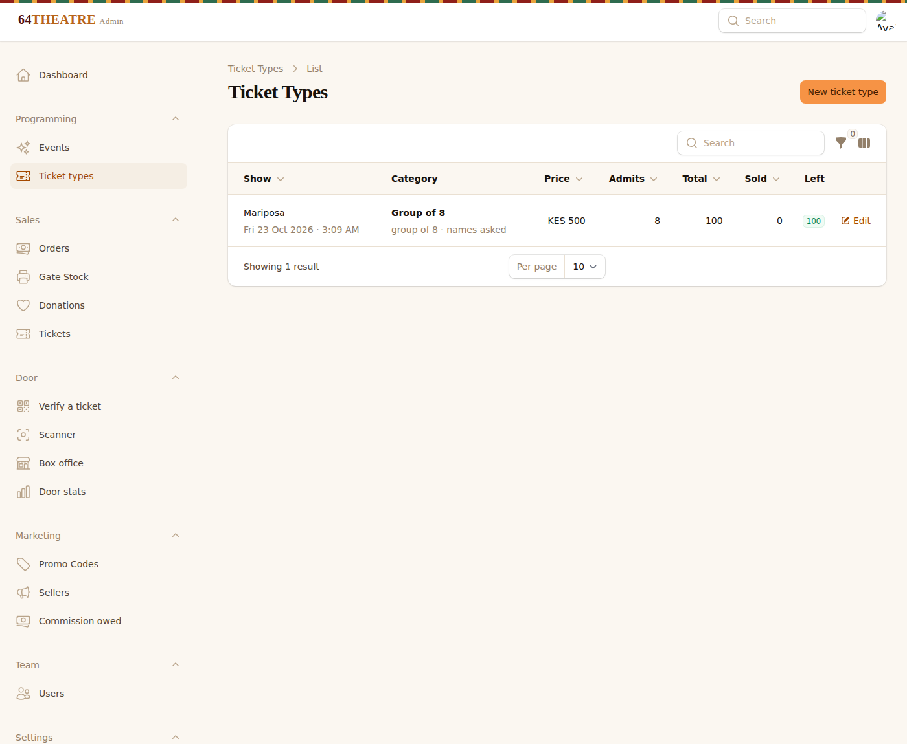
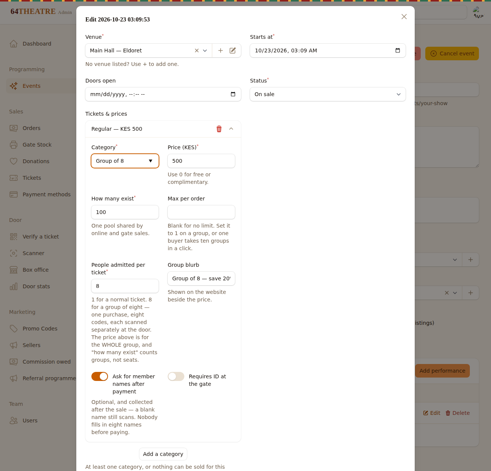

# 64theatre on the Contabo box

Live at **https://tickets.64theatre.art** — see "The domain" below for the
subdomain layout and the switch-over, which must be done DNS-first.

Before the domain existed this ran on `sslip.io` free wildcard DNS, which maps
any IP to a hostname and gets a genuine Let's Encrypt certificate with no
registrar at all:

```
https://64theatre.169-58-127-122.sslip.io
```

That is still the right answer for the next app that has no domain yet — real
certificate, stable URL, no tunnel, so the PWA, the offline gate scanner and
add-to-home-screen all behave as they will in production.

**Shape:** one container (nginx + PHP-FPM), SQLite on a volume, demo content
seeded on boot, fake payment gateway. **~250 MB RAM**, capped at 512 MB. No
Postgres, no Redis, no worker — the staging config runs jobs inline.

---

## Updating the box — one command

```bash
cd /srv/smp-portfolio/repo && git pull
bash deploy/contabo/64theatre/apply-patches.sh --status    # look first
bash deploy/contabo/64theatre/apply-patches.sh             # do it
```

That is the whole deploy. **Use it instead of the per-patch `git apply` lines
in the sections below** — those are kept because they explain what each patch
contains, not because anybody should type thirty of them.

### If you deployed and nothing changed

Three ways that happens, all of which this script removes:

- **`git pull` in `/srv/64theatre/repo` brings nothing.** The changes are not
  in that repo. They are patch files in the portfolio repo, applied on top. A
  pull there succeeds, reports "Already up to date", and changes no code — it
  looks exactly like a deploy that worked.
- **A patch was skipped or applied out of order.** They are cumulative; one
  missing and every later one fails.
- **`docker compose up -d` without `--build`.** The code is copied into the
  image at build time, so the old image keeps serving. The giveaway is the
  compose summary saying `Running` where it should say `Started`.

The script resets the checkout to the upstream commit the patches were cut
from and applies **all** of them, every time. It does not try to work out
which are already in: patches are cumulative, so an early one stops reversing
cleanly as soon as a later one touches the same lines, and detection built on
that is wrong in exactly the cases that matter. Rebuilding from the base is
deterministic — the tree afterwards is byte-for-byte the one the patches were
tested against — and running it twice is harmless.

It then rebuilds with `--build --force-recreate`, runs migrations, and waits
for the container to answer `/up` before claiming success.

**It discards hand edits in `/srv/64theatre/repo`**, saving a diff to
`/srv/64theatre/before-deploy/` first and printing the path. Edit the patches,
not the box.

After it finishes, **hard-refresh the admin** (ctrl-shift-R). The browser
caches the old assets and will otherwise show you the previous screen.

## Deploy

```bash
mkdir -p /srv/64theatre
git clone --depth 1 https://github.com/simboni/64theatre-platform /srv/64theatre/repo

cd /srv/smp-portfolio/repo && git pull
cp deploy/contabo/64theatre/compose.yml deploy/contabo/64theatre/env.example /srv/64theatre/

cd /srv/64theatre
cp env.example .env && chmod 600 .env
```

Set a real `APP_KEY` **before** building — compose validates it even for a
build, and Laravel's key is just `base64:` plus 32 random bytes, so no image
is needed to make one:

```bash
sed -i "s|^APP_KEY=.*|APP_KEY=base64:$(openssl rand -base64 32)|" /srv/64theatre/.env
grep -c '^APP_KEY=base64:' /srv/64theatre/.env    # must print 1
```

Then build:

```bash
docker compose -f /srv/64theatre/compose.yml build
```

`APP_URL` in `env.example` is already `https://tickets.64theatre.art`. It must
match the Caddy hostname exactly — https, no trailing slash. Start it:

```bash
docker compose -f /srv/64theatre/compose.yml up -d
docker compose -f /srv/64theatre/compose.yml logs -f app   # ctrl-C once booted
```

Confirm nothing else moved:

```bash
docker ps --format '{{.Names}}\t{{.Status}}'
```

## Verify before touching anything shared

```bash
docker exec edge-caddy wget -qO- http://64theatre:8080/up
```

`/up` is Laravel's health endpoint — it should return a short HTML page.

## Publish

The domain exists now, so publish the real hostname — `tickets.caddy` in this
directory, and **point the DNS first**. The full sequence is under "The domain"
below; do not skip the `dig` check.

```bash
cp /srv/smp-portfolio/repo/deploy/contabo/64theatre/tickets.caddy \
   /srv/edge/sites/64theatre.caddy
docker exec edge-caddy caddy validate --config /etc/caddy/Caddyfile
```

Only on `Valid configuration`:

```bash
docker exec edge-caddy caddy reload --config /etc/caddy/Caddyfile
curl -sI https://tickets.64theatre.art/ | head -3
```

For an app with no domain yet, an `sslip.io` name needs no DNS work at all —
`<name>.169-58-127-122.sslip.io` already resolves to this box.

The admin login comes from the demo seeder; `ADMIN-GUIDE.md` in the app repo has
the credentials and the walkthrough to hand the client.

---

## The domain — tickets.64theatre.art

The domain is `64theatre.art`, and ticketing lives on **`tickets.64theatre.art`**,
not the apex. Streaming and film are coming and will not be this application;
keeping ticketing on its own subdomain means the public site can be built,
moved or replaced later without touching a system that is taking money.

| Host | Serves |
|---|---|
| `tickets.64theatre.art` | this app — ticketing, orders, box office, admin |
| `64theatre.art`, `www.` | the public site (not deployed yet) |
| `watch.` / `stream.` | streaming (later) |

### 1. DNS first — this order matters

```
A   tickets   169.58.127.122
```

Then wait for it, and do not skip this:

```bash
dig +short tickets.64theatre.art      # must print 169.58.127.122
```

Caddy asks Let's Encrypt for a certificate the instant the config loads, and
Let's Encrypt rate-limits **failed** validations. Reload before the record
resolves and you are locked out of retrying for hours — which is exactly what
happened to `stackup.co.ke`.

### 2. Point the app at it

In `/srv/64theatre/.env`:

```env
APP_URL=https://tickets.64theatre.art
```

```bash
docker compose -f /srv/64theatre/compose.yml up -d
```

> **What this does and does not affect.** `APP_URL` builds the absolute links
> in ticket emails (`route('orders.print', …)`) and the `callback_url` sent to
> the payment gateway. It does **not** appear in ticket QR codes: the payload
> is `64T1.<uuid>.<performance-id>.<expires>.<sig>`, an opaque signed string
> with no URL in it (`app/Services/TicketQr.php`). Tickets already issued keep
> scanning after the move. An earlier version of this README claimed otherwise.

### 3. Publish the hostname

```bash
cp /srv/smp-portfolio/repo/deploy/contabo/64theatre/tickets.caddy \
   /srv/edge/sites/64theatre.caddy
docker exec edge-caddy caddy validate --config /etc/caddy/Caddyfile \
  && docker exec edge-caddy caddy reload --config /etc/caddy/Caddyfile
```

Validate first — an invalid config applies nothing. Reload, never `restart`:
restarting edge-caddy drops every site on the box at once.

Watch the certificate arrive:

```bash
docker logs -f edge-caddy        # "certificate obtained successfully"
curl -sI https://tickets.64theatre.art/ | head -3
```

### 4. Re-point anything that calls back

Anything holding the old sslip.io URL now points nowhere useful:

- **Kopo Kopo dashboard** → webhook `https://tickets.64theatre.art/webhooks/kopokopo`
- **Pesapal**, if used → the IPN is registered through the API, so re-register it
- `BRAND_WEBSITE` in `.env` → the **public site**, not this host. A ticket
  should send someone to `64theatre.art`, not back to the box office. Leave it
  blank until that site exists; blank prints nothing.

### Optional: catch the apex before the main site exists

Until `64theatre.art` has a site, someone typing it gets nothing. If you would
rather send them to the box office, add a **separate** file — never edit the
ticketing one:

```bash
cat > /srv/edge/sites/64theatre-apex.caddy <<'EOF'
64theatre.art, www.64theatre.art {
	redir https://tickets.64theatre.art{uri} 302
}
EOF
```

`302`, not `301`: a permanent redirect is cached by browsers and would fight
you the day the real site goes up. Both names need `A` records first, and
delete the file when the public site is ready.

## Admin patches

Applied in order, against a clean checkout of `simboni/64theatre-platform`:

```bash
cd /srv/64theatre/repo
git apply /srv/smp-portfolio/repo/deploy/contabo/64theatre/patches/0001-event-centred-admin.patch
git apply /srv/smp-portfolio/repo/deploy/contabo/64theatre/patches/0002-venue-create-inline.patch
git apply /srv/smp-portfolio/repo/deploy/contabo/64theatre/patches/0003-kopokopo-and-offline-payment.patch
git apply /srv/smp-portfolio/repo/deploy/contabo/64theatre/patches/0004-admin-ticket-authority.patch
git apply /srv/smp-portfolio/repo/deploy/contabo/64theatre/patches/0005-payment-methods-admin.patch
git apply /srv/smp-portfolio/repo/deploy/contabo/64theatre/patches/0006-payment-waiting-feedback.patch
git apply /srv/smp-portfolio/repo/deploy/contabo/64theatre/patches/0007-prices-on-the-event-screen.patch
git apply /srv/smp-portfolio/repo/deploy/contabo/64theatre/patches/0008-seamless-checkout.patch
git apply /srv/smp-portfolio/repo/deploy/contabo/64theatre/patches/0009-door-menu-and-verify.patch
git apply /srv/smp-portfolio/repo/deploy/contabo/64theatre/patches/0010-gate-mpesa-prompt.patch
git apply /srv/smp-portfolio/repo/deploy/contabo/64theatre/patches/0011-delete-a-ticket.patch
git apply /srv/smp-portfolio/repo/deploy/contabo/64theatre/patches/0012-delete-an-event.patch
cd /srv/64theatre && docker compose up -d --build
```

`0005` adds a table, so it needs its migration — the container runs
`migrate` on boot, so `up -d --build` is enough.

| Patch | What it does |
|---|---|
| `0001-event-centred-admin` | One-step event creation: a three-step wizard that takes performances and ticket prices with the event, performance names instead of row ids, and ticket categories edited from inside the performance |
| `0002-venue-create-inline` | Add and correct venues from the venue dropdown itself |
| `0003-kopokopo-and-offline-payment` | M-Pesa via Kopo Kopo, so tickets sell before the Safaricom paybill exists; plus Pay Bill details for buyers whose prompt never arrives |
| `0004-admin-ticket-authority` | A Tickets screen (there was none), void/reinstate, email + WhatsApp resend, and a payment-method choice when marking an order paid |
| `0005-payment-methods-admin` | **Sales → Payment methods**: switch online payments and the Pay Bill panel on or off, and choose the provider, without a deploy |
| `0006-payment-waiting-feedback` | A spinner while the STK prompt is sent, a locked Pay button, and a live waiting state on the order page |
| `0007-prices-on-the-event-screen` | Ticket categories and prices editable from **Edit event**, which previously had no route to an amount |
| `0008-seamless-checkout` | Three-step checkout, a canonical phone number, resuming an unpaid order instead of duplicating it, and a ticket that does not break on a phone |
| `0009-door-menu-and-verify` | A **Door** menu reaching the scanner and box office, plus verifying a ticket from the office |
| `0010-gate-mpesa-prompt` | The box office can push an M-Pesa prompt to a walk-up customer's phone instead of only taking cash |
| `0011-delete-a-ticket` | Deleting a ticket, singly or in bulk, returning the seat to stock and refusing anything already scanned |
| `0012-delete-an-event` | Deleting an event: says why it is blocked instead of erroring, offers Cancel, and can erase demo shows outright |

`0002` fixes a **go-live blocker**, not a convenience. Venues are created only
inside `demoSeason()` in `database/seeders/DatabaseSeeder.php`, which runs
under `local` and `staging` and *not* under `production` — and no admin screen
creates one. Switching to `APP_ENV=production` (the first line of the section
below) therefore leaves zero venues and no way to add any; since a performance
requires a venue, no event can be created at all. Verified by migrating and
seeding a fresh database with `APP_ENV=production`: **0 venues**.

The staging box hides this completely, because the demo season has already
planted three.

## Setting prices

**Events → edit an event → Performances → Add / edit a performance.** Venue,
times, status and **Tickets & prices** are one form.

`0001` put prices in the creation wizard, but editing afterwards was a dead
end: prices live on `TicketTypesRelationManager`, which hangs off the
Performances resource, and that resource is hidden from navigation. From Edit
event there was no route to an amount at all — a performance could be
scheduled with nothing on sale and no way to fix it without a URL typed by
hand.

Prices are entered in **shillings** and stored as integer cents. The form field
`price_kes` exists only in the form: a fill hook divides on load, create and
save hooks multiply back and drop the display field before it reaches the
model. Verified both directions, including 250.50 → 25050 → 250.5.

## What the admin can do with tickets

Before `0004` the admin had **no Tickets screen at all**. Tickets were created
by a paid order or a printed batch, emailed, and then invisible: "has this
person actually got a ticket?", "has this code been used?" and "that one is a
duplicate, kill it" had no answer anywhere in the office. The gate app could
scan a code; nobody could look one up.

**Sales → Tickets** now lists every issued ticket, searchable by short code,
holder name or phone — including from the global search bar, so a code read
over the phone goes straight to the ticket.

| Need | Where |
|---|---|
| Find a ticket by its code | Sales → Tickets, or the search bar |
| See whether it has been used | `status` column; `redeemed` means it went through the gate |
| Show the QR again at the counter | Open the ticket — it renders the live signed QR |
| Kill a duplicate or leaked code | **Void** (reason required, audited) |
| Undo that | **Reinstate** — not offered for a redeemed ticket, which has already walked through the door |
| Re-send tickets by email | Orders → **Email tickets**; the address is saved to the customer |
| Send by WhatsApp | Orders or Tickets → **WhatsApp** |
| Record a payment taken outside M-Pesa | Orders → **Mark paid**, now with a method and reference |

**Generating** tickets is **Sales → Ticket batches** — `BoxOffice::createBatch()`
pre-prints gate stock against a ticket type's inventory. Tickets are
deliberately not created from the Tickets screen: both real routes hold
inventory against the ticket type, and minting one by hand would oversell the
house.

### Deleting an event

Deleting an event that had sold anything failed with **"error while loading
page"** — true, useless, and indistinguishable from the app being broken.

The cause is the schema, and it is correct. `performances.event_id` and
`ticket_types.performance_id` cascade, but `orders.performance_id`,
`tickets.performance_id` and `checkins.performance_id` do **not** — a show
people paid for should not vanish because somebody clicked the wrong row. The
database refuses with `SQLSTATE[23000] FOREIGN KEY constraint failed`, and
nothing turned that into a sentence.

**Edit event** now offers whichever applies:

| | |
|---|---|
| **Delete** | Only when nothing is sold. Performances and ticket types cascade. |
| **Delete** (greyed) | Explains what is in the way — "This event has 4 orders (2 paid), 2 issued tickets, 1 check-in." |
| **Cancel event** | The right answer for a real show that is not happening: off the website, history kept, refunds still reconcilable. |
| **Erase event and all sales** | Super admin only. Deletes orders, payments, ledger entries and tickets in dependency order. |

The erase action requires the event title to be typed, and says plainly that
money taken through M-Pesa is **not** refunded by it and cannot be reconciled
once the records are gone. It is for demo data, not for a show that sold real
tickets.

Verified both: a clean event deleted with its cascades (performances 7 → 6,
types 16 → 13), and a blocked one purged 1 check-in, 2 tickets, 4 ledger
entries, 3 payments, 4 order items and 4 orders before removing itself.

### Deleting a ticket

Super admin only, on **Sales → Tickets**, singly or by selecting several.

**Void and delete are different things and the difference matters.** Void keeps
the record and stops the ticket working — that is what a real sold ticket
needs. Delete erases it, and is right for a test sale or something created by
mistake.

Two things delete has to get right, which is why it was not simply a button:

- **The seat goes back on sale.** `quantity_sold` is incremented when a ticket
  is sold and nothing decrements it on delete, so a naive delete would leave
  the seat counted as sold for ever — the house reading full with an empty
  chair. Verified: `quantity_sold` 5 → 4, remaining 245 → 246.
- **A scanned ticket is refused.** `checkins.ticket_id` is a constrained
  foreign key, so deleting a ticket somebody came in on fails at the database
  with an integrity-constraint error. Confirmed by scanning a ticket and trying:
  `SQLSTATE[23000] FOREIGN KEY constraint failed`. It is also evidence that a
  person walked through the door. The action checks first and says so, and the
  bulk action skips them and reports how many.

Every delete is written to the audit log with the short code.

### Sending tickets

Email is the default and goes automatically on payment — but only when the
buyer has an email address, and a box-office or Pay Bill buyer often has none.
**Email tickets** takes an address at the counter and saves it to the customer,
so it is typed once.

**WhatsApp** opens the buyer's chat in the operator's own WhatsApp with the
message ready to send. A server-side send would need the WhatsApp Business API,
an approved template and a per-message fee; this costs nothing and arrives from
a number the customer recognises. The button is hidden when the stored number
is not a Kenyan mobile, because `wa.me` opens an empty chooser for a malformed
number and that looks like it worked.

What is shared is the buyer's own order page — the same unguessable URL the
confirmation SMS already sends, carrying the QR codes and the print view. It is
the whole ticket, not a pointer to one.

### Payment method

**Mark paid** previously recorded every manual payment as `bank_transfer`,
whatever had actually happened. It now asks for the method (M-Pesa, cash, bank
transfer, card) and a reference — the M-Pesa code, bank reference or receipt
number — both of which go to the ledger and the audit log. A blank reference
generates one prefixed `MANUAL-`, so it can never be mistaken for something a
gateway returned.

## Payment methods, from the admin

**Sales → Payment methods**, super admin only, every change audited with its
previous value.

- **Accept payments online** — off refuses checkout before an order is
  created, so switching payments off during an outage does not strand seats in
  unpaid orders that only release when they expire.
- **Provider** — Kopo Kopo, Pesapal or Daraja. The page refuses a provider
  whose credentials are missing, and says so, rather than letting a buyer find
  out. It also warns when the chosen provider is pointed at its sandbox, where
  payments look successful and no money moves.
- **Show Pay Bill details** — the buyer-facing offline panel.

Credentials are **not** editable here and never will be. A form that could
change where money settles turns a stolen admin session into a theft, so the
provider can be chosen in the browser but only configured in `.env`.

`fake` is not offered either. It confirms orders and issues real tickets for
nothing — indispensable in testing, catastrophic in production, and a dropdown
is exactly how it would get picked by accident. It stays reachable through
`PAYMENT_GATEWAY` in `.env`, where choosing it takes deliberate effort.

And since this is now selectable, an unset or misspelled value no longer falls
through to the fake gateway in silence: **in production it throws.** A broken
checkout is bad; a silently free one is worse, and would not be noticed until
the takings were counted.

## Taking money before the Safaricom paybill exists

`0003` adds Kopo Kopo, an M-Pesa aggregator. It sells through Kopo Kopo's own
till and settles to the client's account, so tickets can go on sale now rather
than after Safaricom approves a paybill in 64 Theatre's name — which takes
weeks. Switch `PAYMENT_GATEWAY=daraja` when it lands; nothing else in the
application changes, which is what the `PaymentGateway` interface is for.

```env
PAYMENT_GATEWAY=kopokopo
KOPOKOPO_BASE_URL=https://api.kopokopo.com   # sandbox.kopokopo.com while testing
KOPOKOPO_CLIENT_ID=...
KOPOKOPO_CLIENT_SECRET=...
KOPOKOPO_API_KEY=...                         # signs webhooks — NOT the client secret
KOPOKOPO_TILL_NUMBER=...
```

Set the webhook in the Kopo Kopo dashboard to `https://<host>/webhooks/kopokopo`.
It is verified by HMAC-SHA256 over the raw body using `KOPOKOPO_API_KEY`; an
unsigned or forged request gets a 401 and is never acted on.

Three things that bite:

- Success from the STK call is **201 with the handle in the `Location`
  header**, not in the body.
- `KOPOKOPO_API_KEY` is a **different secret** from the client secret. Swapping
  them authenticates fine and then fails every single callback.
- Live keys against the sandbox URL fail authentication, and the error does not
  say why.

Payments are stored with `gateway = 'aggregator'`, the value Pesapal already
uses, because that column is an enum and adding a value would mean an enum
migration — which on SQLite rebuilds the table holding live payment records.
The provider is recorded in `gateway_payload.provider`.

### Paying by hand

The STK prompt does not always arrive. The order page now also shows:

```
Pay Bill  →  Business number 542542 (I&M Bank)
             Account number  064064
```

Change them with `OFFLINE_PAYMENT_PAYBILL` / `_ACCOUNT` / `_BANK`, or hide the
panel with `OFFLINE_PAYMENT_ENABLED=false`.

**This is not reconciled automatically**, and the page says so to the buyer.
The account number identifies 64 Theatre to Kopo Kopo — it is not per-order, so
there is nowhere to put a reference. The buyer is told to keep the M-Pesa
confirmation SMS and quote their order number at the box office. Budget for
someone matching those by hand, or keep the panel off until you have a process
for it.

## The door

The scanner, box office and door stats have always existed, at `/gate`,
`/gate/sell` and `/gate/stats` — but **nothing in the admin linked to them**.
They were reachable only by knowing the URL, so somebody who saw the scanner
once had no way back to it.

A **Door** group now carries all three, opening in a new tab because the door
is worked alongside the office rather than instead of it.

| | |
|---|---|
| **Verify a ticket** | In the admin — look a code up without spending it |
| **Scanner** | `/gate` — the phone-at-the-door QR scanner |
| **Box office** | `/gate/sell` — selling printed stock and new tickets |
| **Door stats** | `/gate/stats` — what has come through |

### Selling at the gate

**Door → Box office → Sell new e-ticket (walk-up)** now asks how the customer
is paying:

- **M-Pesa** — pushes the STK prompt to their handset and waits
- **Cash** — unchanged: taken at the desk, tickets issued immediately

Before this the box office could only take cash. `sellNew` hardcoded
`'gateway' => 'cash'` and confirmed the order on the spot, so a walk-up who
wanted to pay by phone had to be sent to the website.

**The operator never marks an M-Pesa sale paid.** The order stays
`awaiting_payment` with zero tickets until the Kopo Kopo webhook says the money
arrived. That is deliberate: a button the operator can press to issue a ticket
is a button that lets people in for free, and at a busy door nobody is checking
whether the payment really completed.

The screen shows a live "Waiting for payment — KES X" panel naming the number
the prompt went to, polling the same `orders.status` endpoint the buyer's own
page uses, so there is one definition of paid. When the money lands the panel
turns green and offers **Print tickets**.

If the prompt cannot be sent at all, it says so and tells the operator to take
cash and record it as cash — rather than leaving them staring at a screen that
will never change.

### Verifying from the office

The scanner is the right tool at the door. **Door → Verify a ticket** is for
the other half of the job: a code read out over the phone, a printed list to
settle, or an argument about whether a ticket has already been used.

Choose the performance, type the eight characters under the QR, and it answers
one of:

| | |
|---|---|
| **Valid — admit** | Issued, for this performance, unused |
| **Already used** | With the time it went through the gate |
| **Wrong performance** | Naming the night it is actually for |
| **Void** / **Refunded** | Killed, or money returned |
| **No such ticket** | Nothing matches that code |

**Checking never spends the ticket.** Admitting is a separate, confirmed
button that appears only after a check says the ticket is good. That
separation is the point: the common case is answering a question, and a lookup
that silently redeemed would turn every enquiry into a used ticket and a row at
the door. Admitting goes through the same `GateCheckin` service the scanner
uses, so duplicates are caught and audited identically.

## Buying a ticket

Checkout is three steps: **Tickets → Details → Confirm and pay**. It was one
screen carrying every ticket category, four form fields and a Pay button at
once. Stepping it is only about how much is visible — the form posts exactly as
before, and with JavaScript off every step is revealed, so it degrades to the
single long form it used to be.

Only two fields are required: the M-Pesa number the prompt goes to, and the
email the tickets go to. Name and promo code sit behind a disclosure, because
most buyers have neither and every visible field is another reason to stop. The
last screen has nothing to fill in — before money moves, a screen should be
read, not worked through.

### Paying twice

A buyer who started paying, lost the page and came back used to create a second
order and a second STK prompt. If the first one then completed, they paid twice
for the same show.

Now, before an order is created, an unexpired unpaid order for the same phone
and the same performance sends them back to the one they already have. Scoped
to the performance, because buying for a different night is genuinely a new
order.

That only works because the phone number is now canonical.

### One buyer, one phone number

`Customer::firstOrCreate(['phone' => …])` stored the number exactly as typed,
so `0712345678`, `+254712345678` and `254 712 345 678` were **three different
customers** for one person — tickets split between them, "My tickets" finding
only one, and no reliable way to ask whether a buyer already had an order.

`App\Support\Phone` normalises to `2547XXXXXXXX` at both customer-creating
sites and in the lookup. Verified across six input formats.

### Accounts

There are none, and there should not be. The phone number is the identity, it
is the thing M-Pesa confirms against, and an account is friction in front of a
purchase. A returning buyer uses **My tickets** with their phone number.

> **One thing to decide.** That lookup takes a phone number and returns the
> orders and ticket short codes for it; the ticket code is optional. A short
> code is what admits someone at the gate, so anyone who knows a buyer's phone
> number can read their tickets. Requiring the code, or sending a one-time
> code, would close it. Flagged rather than changed, because requiring the code
> also means a buyer who lost it cannot self-serve.

### The ticket on a phone

The ticket was built as a 1fr + 208px stub. At 360px the stub took more than
half the width, and the masthead's absolutely positioned "ADMIT ONE" band and
language badge printed straight over the event title.

It now stacks below 560px: title full width, facts wrapped, stub underneath,
QR up from 118px to **190px** — easier to scan off a screen, which is how most
people will present it. Verified at 360px in a real browser: zero horizontal
overflow, title 312px wide, stub below the body, nothing overlapping.

## While the buyer waits

Reaching Kopo Kopo and Safaricom takes a few seconds, and until the prompt
lands on the handset the page looks like nothing happened. `0006` fills that
silence:

- The **Pay button locks on submit** and becomes a spinner reading "Sending
  prompt to your phone…". That also closes a real bug: nothing prevented a
  second press, and two presses created two orders, held two sets of seats and
  sent two STK prompts.
- The **order page shows a pulsing "Waiting for your payment…"** naming the
  number the prompt went to, and says the page updates on its own — it already
  polled and reloaded itself, but silently, so a buyer who had already paid sat
  looking at a still screen wondering whether to pay again.
- After **25 seconds** a second line offers the Pay Bill fallback. Delayed on
  purpose: shown immediately it reads as "this is broken" before the prompt has
  had a fair chance to arrive.

Both respect `prefers-reduced-motion`.

## Email (Brevo)

`compose.yml` shipped with `MAIL_MAILER: log` hardcoded, which writes ticket
emails to the container log and delivers them to **nobody** — the job runs,
the mail "sends", the buyer gets nothing. That is fine for a demo and a silent
failure the moment real tickets are sold.

In `/srv/64theatre/.env`:

```env
MAIL_MAILER=smtp
MAIL_HOST=smtp-relay.brevo.com
MAIL_PORT=587
MAIL_SCHEME=smtp
MAIL_USERNAME=<Brevo SMTP login>
MAIL_PASSWORD=<Brevo SMTP key, xsmtpsib-…>
MAIL_FROM_ADDRESS=tickets@64theatre.art
MAIL_FROM_NAME=64theatre
```

```bash
docker compose -f /srv/64theatre/compose.yml up -d
```

Three things that bite:

- **`MAIL_SCHEME`, not `MAIL_ENCRYPTION`.** Laravel 13 renamed it
  (`config/mail.php:42`). The old name is read by nothing and fails silently.
  `smtp` on port 587 negotiates STARTTLS; port 465 needs `smtps`.
- **The SMTP key is not the API key.** Brevo's SMTP key is `xsmtpsib-…`; the
  API v3 key is `xkeysib-…` and will not authenticate over SMTP.
- **`MAIL_FROM_ADDRESS` must be a sender Brevo has authenticated** for the
  domain, or Brevo rejects the message outright.

### Test it before a customer does

```bash
docker compose -f /srv/64theatre/compose.yml exec app php artisan tinker --execute='
Illuminate\Support\Facades\Mail::raw("64theatre SMTP test", function ($m) {
    $m->to("you@example.com")->subject("64theatre — SMTP test");
});
echo "sent via ", config("mail.default"), " as ", config("mail.from.address"), PHP_EOL;'
```

An authentication failure throws immediately and names the reason. Silence
plus a delivered email means it works.

### The daily cap

Brevo's free plan allows **300 emails a day across the whole account**. If
64 Theatre shares an account with another product, they share that ceiling,
and Brevo stops sending rather than queueing — a buyer simply gets no ticket.
A show selling a few hundred tickets wants either its own account or a paid
plan.

## What it costs to take money (patch 0016)

```bash
cd /srv/64theatre/repo && git pull
git apply --check /srv/smp-portfolio/repo/deploy/contabo/64theatre/patches/0016-service-fees-and-two-broken-pages.patch \
  && git apply /srv/smp-portfolio/repo/deploy/contabo/64theatre/patches/0016-service-fees-and-two-broken-pages.patch
docker compose -f /srv/64theatre/compose.yml up -d --build
docker exec 64theatre-app php artisan optimize:clear
```

A **Service fees** panel on the dashboard, beside the sales figures, and its
parameters under **Sales → Payment methods**. Three stats:

- **Service wallet** — the live PayHero balance. This is the one that stops a
  show selling: PayHero spends a *prepaid* service wallet to send each prompt,
  separate from the money being collected, and an empty one refuses every
  prompt while the credentials, the channel and the callbacks all still look
  perfect. It goes red below a floor you set.
- **Fees this month**, **gateway fees to date** — estimated at the agreed rate,
  over confirmed gateway payments only. Cash at the door is excluded; it costs
  PayHero nothing.

**They are estimates and the screen says so.** PayHero's callbacks on this
account report `cost: 0`, so a figure presented as actual would be confidently
wrong. The rate you enter is the thing actually known, so the fee is derived
from it. If PayHero ever starts returning a real cost, prefer that.

The wallet lookup is cached for five minutes, times out in eight seconds, and
returns "Unavailable" on any failure. A third-party call on a dashboard must
not be able to take the dashboard down. Saving the settings clears that cache,
so a top-up shows immediately.

Rates default to zero — nothing is charged until somebody enters it.

## Two pages that did not work

### Door stats

The Door menu linked **Door stats** straight at `route('gate.stats')`. That
route is a JSON endpoint the scanner polls, and it needs a `performance_id` it
was never given — so the office got `{"checked_in":0,"issued":0}`, always zero,
with no way back. My mistake, in patch 0009: a menu item has to point at a
page.

There is now a real **Door → Door stats** page: pick a performance, see how
many of the issued tickets have come in, the percentage, and how many are
still to arrive. Read-only on purpose — admitting and verifying have their own
screens, and a count somebody watches during a performance should not also be
somewhere a ticket can be spent by a mis-click.

### Creating an order from the admin

The form was generated from the database table and could not have worked. It
asked a human to invent a **UUID**; it typed `channel` and `status` into free
text when both are **enum** columns, so one typo throws; it listed performances
as bare numeric ids; it wanted the money in **cents**; and after all that it
created an order with **no tickets attached**.

It now asks what someone at a desk knows — which performance, how many of what
type, whose phone number — and hands it to the same `Checkout` service the
website and the box office already use. That service owns the oversell guard,
promo validation, customer de-duplication by phone, the uuid, the totals and
ticket issuing. Writing any of that again here would mean a second copy of the
rules that quietly disagrees with the first.

**M-Pesa is deliberately not a payment option on that form.** An STK payment is
confirmed by its webhook when the money actually lands; letting an operator
declare one received is how a theatre issues tickets for money it never got.
Cash and bank transfer are there, because a person can vouch for those.

On the edit screen, status and channel are now dropdowns rather than free text,
and the money fields are shown but not editable — changing a total there would
not change the tickets, the payments, or anything the customer is holding.

Patch **0017** is the other half of this and is required: `OrderResource`
declared `canCreate(): false`, so Filament blocked the create route and hid the
action — the form could be perfect and the page still would not open. It was
false for a good reason, since the generated form could not produce a valid
order; now that creating goes through `Checkout`, it is opened to the roles
that handle money (`super_admin`, `admin`, `finance`, `gate`), matching the
Door screens. Donations and Tickets stay read-only.

```bash
git apply /srv/smp-portfolio/repo/deploy/contabo/64theatre/patches/0017-allow-creating-an-order.patch
cd /srv/64theatre && docker compose up -d --build --force-recreate
```

**`--force-recreate` is not optional.** Compose reuses a running container when
it judges nothing changed, and this app's code is baked into the image — only
`storage/app` is a volume. A rebuild without a recreate leaves the old code
serving, and the summary line reads `Running` rather than `Started`. That one
word is the difference between deployed and not.

> **Not verified at runtime.** This repo has no `vendor/` in my working copy,
> so I could lint the PHP and check every Filament call against existing usage
> in this codebase, but I could not boot the panel. Open the three screens
> after deploying — dashboard, Door stats, and creating one order — before
> trusting them in front of a customer.

## Upgrading to production

Apply `0002` **before** this section, or the first thing a production install
does is refuse to create an event.

The demo config is deliberately not the live config. For real ticket sales the
repo's `DEPLOY.md` calls for:

- `APP_ENV=production`, a **fresh** `APP_KEY`, `SEED_ON_BOOT=false`
- `PAYMENT_GATEWAY=daraja` with production `DARAJA_*` credentials
- **PostgreSQL** instead of SQLite (`DB_CONNECTION=pgsql` + a `db` service)
- **Redis** + `QUEUE_CONNECTION=redis` and a **worker container**
  (`php artisan queue:work`)
- Real `MAIL_*` and `SMS_ENABLED=true` for ticket delivery
- Nightly database backups

Ask me when you reach that point and I'll extend this compose file — it's an
additive change, and the SQLite data can be migrated across.

## Safety

- No host ports. `edge-caddy` keeps 80/443.
- Its own compose project, volume and image — it cannot touch smpcredits,
  riziki, fitgen, cosdep, talithakum, stackup or the portfolio.
- `mem_limit: 512m`, so a runaway process can't starve the box.
- Always use `-f /srv/64theatre/compose.yml` so a command can never act on
  another project.

## A settings section, and Ticket types on the sidebar (patch 0034)

No migration. Safe on any day.

```bash
cd /srv/64theatre/repo && git pull
git apply /srv/smp-portfolio/repo/deploy/contabo/64theatre/patches/0034-settings-section-and-ticket-types.patch
cd /srv/64theatre && docker compose up -d --build --force-recreate
```

### Settings → All settings



Everything the theatre can change without a deploy is now on **one page**, in
four tabs:

| Tab | What is on it |
| --- | --- |
| **Taking money** | Accept payments online, which provider, show Pay Bill details |
| **What it costs us** | Gateway % and flat fee, platform monthly, wallet warning level |
| **Selling on commission** | Run referrals, house rate, hold hours, per-order cap, discounted orders |
| **Server** | Read-only: environment, email, SMS, public website, scheduled work |

It replaces **Sales → Payment methods** and **Marketing → Referral programme**,
which were two pages in two different sidebar groups, with everything not on
one of them invisible. Those two are gone; their settings are unchanged and
carried over as they were.

**Credentials are still not editable from a browser, and that is deliberate.**
A form that could change where money settles would turn a stolen admin session
into a theft. Gateway keys, the M-Pesa channel, the mail password and the SMS
key stay in the server environment. The **Server** tab shows what is
configured so you can see the state without being able to change it — whether
email actually goes out, whether this is production, whether SMS is on.

Super admin only. Every save is written to the audit log with the previous
values, and only the fields that actually moved, because "it used to be 10%"
is the question somebody always asks.

### Ticket types, on the sidebar



**Programming → Ticket types.** Every category on the box in one list — show,
category, price, admits, total, sold, left — searchable, filterable by show,
by "group tickets only", and by "still has tickets left". **New ticket type**
creates one: pick the performance, name it, set **People admitted per ticket**.

This was hidden by an earlier decision that prices belong inside the
performance they are for, and that a flat list of every price the theatre has
ever set is not how anyone looks for one. The reasoning is sound and it was
still wrong: the person running the theatre went looking for "ticket types"
three separate times and there was nothing by that name anywhere.

Both routes now exist and edit the same rows. Setting prices while scheduling
a performance is still the better flow; this is for when you know what you
want and want it by name.

The generated table it shipped with has also been made readable — it used to
show `performance.id` and a price in cents.

## The member-names switch (patch 0033)

No migration. Apply it with 0032.

```bash
cd /srv/64theatre/repo && git pull
git apply /srv/smp-portfolio/repo/deploy/contabo/64theatre/patches/0033-member-names-switch.patch
cd /srv/64theatre && docker compose up -d --build --force-recreate
```

Found by opening the admin in a browser and looking at it, which is how this
should have been checked two patches ago.

**"Ask for member names after payment" did nothing.** It was saved on the
ticket type, cast on the model, and read nowhere — so a theatre that switched
it off was asked for names anyway. It now controls whether the buyer is
offered the roster link on their order page. The group panel itself stays
either way: how many of your party are in is worth knowing whether or not
anybody is named.

**And it read as off on every group.** The form declared it on by default, but
a default only applies to a brand new row, and the column's default is false.
So taking an existing "Regular" and setting it to admit eight left the switch
off, the buyer was never offered the roster, and nothing on screen said the
feature was half on. Raising **People admitted per ticket** above 1 now
switches it on — only on that transition, so switching it off deliberately
stays off.

## Where group tickets actually are (patch 0032)

**Apply this instead of relying on 0030.** No migration, safe on a show night.

```bash
cd /srv/64theatre/repo && git pull
git apply /srv/smp-portfolio/repo/deploy/contabo/64theatre/patches/0032-group-fields-in-the-performance-modal.patch
cd /srv/64theatre && docker compose up -d --build --force-recreate
```

### The path

**Events → open the event → Performances → Edit → "Tickets & prices"**



That is the real screen, captured from the running admin — the sidebar has no
"Ticket types" item and will not get one. Categories are set in a repeater
inside the performance modal. Open a category and the group fields are at the
bottom:

| Field | What to put |
| --- | --- |
| **Category** | Group of 8 |
| **Price (KES)** | the price of the **whole group** — 12000, not per head |
| **How many exist** | the number of **groups** — 5 means 5 groups, 40 people |
| **Max per order** | `1` |
| **People admitted per ticket** | `8` — this is what makes it a group |
| **Group blurb** | appears once admits is above 1 |
| **Ask for member names** | leave on |

### Why this took three goes

The group fields had been added **twice** to forms nobody can open:

- **0027** put them on `TicketTypeResource`'s form. That resource is off the
  sidebar by design — a flat list of every price the theatre has ever set is
  not how anyone looks for one.
- **0030** added them to the `TicketTypes` relation manager, which lives on the
  performance's **own page**. That page is also off the sidebar, and nothing in
  the interface links to it: the Performances list edits in a **modal**. So the
  column there would tell you a performance had four ticket categories with no
  way to open them.

The screen people actually use is the repeater in the performance modal, and
that is where they are now. The earlier two copies are harmless and reachable
by URL, so nothing was removed.

**The lesson, written down because it cost two patches:** a field is not
shipped when the form has it. It is shipped when a test drives the screen a
person opens. The group tests all proved the machinery — fan-out, roster,
oversell guard, headcount, website blurb — and none of them proved the feature
could be switched on. There is now a test that opens the event edit page and
creates a group through the modal, and it fails if the fields are not there.

## Referral review fixes (patch 0031)

**Apply this with 0029. Do not run 0029 on its own** — one of these is a way
for anyone to take the public site down with a URL.

```bash
cd /srv/64theatre/repo && git pull
git apply /srv/smp-portfolio/repo/deploy/contabo/64theatre/patches/0031-referral-review-fixes.patch
cd /srv/64theatre && docker compose up -d --build --force-recreate
docker compose exec app php artisan migrate --force
```

An adversarial review of 0029 found these. Each one is now covered by a test
that fails without the fix.

### Anyone could 500 every public page with a URL

`?ref[]=ABCD` makes the query parameter an **array**. `blank(['ABCD'])` is
false, so the guard let it through, and casting an array to a string is a PHP
warning that Laravel rethrows as an exception — an HTTP 500. The referral
middleware runs on the **whole web group**, so that was the homepage and every
event page of a live ticket shop, brought down deliberately with a URL or by
accident by a mangled share link. It fired with the programme switched **off**
too, because the enabled check sat inside the function being called.

A crafted `ref[]=` **cookie** did the same to the checkout POST itself.

This is the reason 0029 must not go out alone.

### A clawback was collected for ever

When commission had already been paid on a ticket that was later refunded, the
amount was recorded as owed back — and nothing ever marked it settled. The
seller's page subtracted it from **every future payout, indefinitely**: one
KES 100 clawback shorted them KES 100 on every payout run they ever had.

Worse, the two screens disagreed. The seller's page showed the net while the
admin showed the gross, and the payout action summed the gross — so the office
over-paid from one figure while the seller was under-reported against another,
for the same money.

Now there is a column recording how much of each clawback has been recovered,
and the payout action does the netting itself: **the figure in the confirm
dialog is the figure to send**, per seller, and the debt is cleared once. A
clawback larger than the payout stays partly outstanding rather than becoming
a debt nobody is told about. Needs the migration above.

### Knowing a seller's phone number got you their earnings page

Submitting an already-registered number redirected straight to that seller's
dashboard — and the dashboard URL is the only credential that page has, and it
never rotates. So anyone in the group chat where she shared her link could
type her number into the signup form and get permanent access to her page, her
name and her negotiated rate. No new row was created, so nothing in the logs
said it had happened.

Now the link is **emailed** to the address on the account, and the reply says
the same thing whether or not the number was registered. With no email on
file, the box office sends it — they can read it off the admin. The seller's
page no longer prints a phone number at all.

### "Erase event and all sales" was broken

Group tickets (0027) and referral commissions (0029) both added tables
pointing at `orders`, and neither was added to the delete order. Purging an
event that had sold **one** group ticket or **one** referred ticket failed on a
foreign key — and those are exactly the events that button exists for. It was
inside a transaction so nothing was half-deleted; the operator just got an
unexplained error on an action with no alternative. There are now four tests
over that path, so the next feature that adds such a table breaks a test
instead.

### Smaller ones

- **Editing a seller's phone crashed** when the new number collided with
  another only after normalisation — uniqueness was checked on the raw text
  while normalising happened after validation. It is the single most likely
  edit on that form. Now refused with a message naming who holds the number.
- **"House rate" and "KES 0" rendered as blank cells.** Filament skips the
  formatter entirely when a value is null, so those branches never ran. A
  blank "Owed now" reads the same as zero.
- **The scheduler's promotion pass skipped rows.** It paged by offset while
  changing the column it filtered on, so each page after the first jumped past
  rows it never looked at. Self-healing on the next run, but "most of them,
  eventually" is a poor property for a list of money owed.
- **The "pay commission on donations" toggle could never work** — the donation
  checkout carries no referral at all — so it has been removed rather than
  left promising an operator something the code cannot do.

## Group fields where you can see them (patch 0030)

```bash
cd /srv/64theatre/repo && git pull
git apply /srv/smp-portfolio/repo/deploy/contabo/64theatre/patches/0030-group-fields-where-you-can-see-them.patch
cd /srv/64theatre && docker compose up -d --build --force-recreate
```

No migration. Safe on any day, including a show night.

**Patch 0027 added the group fields to the wrong form.** They went onto
`TicketTypeResource`, which is deliberately off the sidebar — prices are edited
inside the performance they belong to — so there was no screen in the admin
where a group could actually be created. Everything underneath worked: the
fan-out, the roster, the oversell guard, the headcount, the website blurb. The
one switch was behind a door with no handle.

They are now on **Events → the event → Performances → the performance →
Tickets & prices**, which is the screen somebody running a show actually
opens. The list there also marks a group ("group of 8") under the category
name, because "Total 10" on an admits-8 type reads as ten seats when it is
eighty.

A test now creates a group **through that screen** rather than through the
model, which is the test that was missing — the old ones all proved the
machinery and none of them proved it could be reached.

## The scheduler was never running

**Do this whether or not you want referrals.** It is not part of patch 0029 —
it is a gap in the deployment that the referral work uncovered.

```bash
cd /srv/smp-portfolio/repo && git pull
bash deploy/contabo/64theatre/scheduler.sh --install-cron
bash deploy/contabo/64theatre/scheduler.sh --status
```

The container is nginx and PHP-FPM. There is no cron inside it and no worker
container beside it, so `routes/console.php` has been a list of tasks that
never ran:

- **`release-expired-orders`, every minute.** An abandoned checkout holds its
  seats until this runs. Every buyer who started paying and walked away has
  been taking those seats off sale **permanently**. There is no error anywhere
  — the show simply has fewer tickets than it should, and on a sell-out that
  is money lost silently. This is the one that matters today.
- **`promote-referral-commission`, hourly.** New in 0029. Without it nothing
  ever becomes payable.

`--status` is honest about the difference between installed and working: it
checks the log was written to in the last five minutes, because a cron entry
that exists and fails every minute looks identical to a healthy one from the
crontab alone.

To see what the seats situation is right now:

```bash
docker exec 64theatre php artisan tinker --execute="echo App\Models\Order::where('status','awaiting_payment')->where('expires_at','<',now())->count().' expired orders still holding seats';"
```

Running the scheduler releases them.

## Selling on commission (patch 0029)

**Do not deploy this on a show night.** It adds a migration.

```bash
cd /srv/64theatre/repo && git pull
git apply /srv/smp-portfolio/repo/deploy/contabo/64theatre/patches/0029-referrals.patch
cd /srv/64theatre && docker compose up -d --build --force-recreate
docker compose exec app php artisan migrate --force
```

**It arrives switched off**, and stays off until somebody turns it on at
**Marketing → Referral programme**. While it is off, `/sell-tickets` is not
reachable, no link earns, and nothing changes for anyone. That is deliberate:
a commission scheme that switched itself on because a patch was applied would
be promising strangers money the theatre never agreed to pay.

### How it works

Somebody signs up at **`/sell-tickets`** — name, phone, and the M-Pesa number
they want paying on. They get a link of their own (`…/?ref=THEIRCODE`) and a
page at `/r/<uuid>` showing the link, a WhatsApp share button, and what it has
earned. No account and no password: they are members of the public, and
`users` is the staff table that reaches `/admin`.

They arrive **pending**. The link works immediately as a link but earns
nothing until somebody approves them at **Marketing → Sellers**, which is one
click, confirmed, and written to the audit log with a name against it. So you
can hand links out at a show without having promised anything.

Commission then has **three** states, which are three different facts:

| State | Means |
| --- | --- |
| `earned` | money landed, the show has not happened yet |
| `payable` | the show happened, the order is still paid — safe to send |
| `paid` | somebody actually sent the M-Pesa |

An hourly task moves `earned` → `payable` once the performance has passed plus
the hold you set. It **re-reads the order every time** rather than trusting the
decision made at the sale, so an order refunded in the meantime never matures.

### Attribution

First touch, not last. The code is stored in an httpOnly cookie for 30 days
and **only if there isn't one already** — a ticket link gets forwarded through
WhatsApp groups, and last-touch would let whoever reshared it last take the
commission from whoever actually found the buyer. That is the argument you
would then have to referee.

The code is re-checked at checkout, so one revoked between the click and the
purchase earns nothing.

### What cannot earn

- **Your own ticket.** Matched on the canonical phone and on the linked
  customer record. It is not an edge case, it is the first thing anyone tries.
- **A box-office sale.** A walk-up at the desk was not brought in by a link.
- **A discounted order**, unless you switch that on. A promo code and a
  commission on the same sale can take the margin below zero.
- **A donation**, unless you switch that on. A gift to the theatre is a
  different proposition from a ticket sale.
- **The same order twice.** There is a unique index on `order_id`, so whatever
  future code path confirms an order again, it cannot earn again.

### Refunds

Money that went back must never stay payable. Not yet paid, the commission is
voided. **Already paid, it becomes a clawback** — its own column, netted off
the next payout, because the amount columns are unsigned and a clawback is a
separate fact from the original earning. Both refunding and cancelling do this.

### Paying people

**Nothing here sends money.** You see what is owed at **Marketing →
Commission owed**, filter to one seller, send one M-Pesa for the total, and
record it with "Mark selected as paid". It refuses any row that is not ready to
pay rather than skipping it quietly, so the figure on screen is the figure you
send.

> **This has a tax question and it is not mine to answer.** Paying commission
> to members of the public is taxable income to them, and Kenya puts
> withholding-and-remit obligations on the payer. There is a KRA PIN field on
> each seller for when your accountant says it is needed; nothing in the
> system uses it. **An accountant sets the rate before the first payout.** That
> is also why there is no automatic disbursement: an automated money-out path
> built on a guess at tax law would be worse than a spreadsheet.

### Rates

The house rate applies unless a seller has their own negotiated one. Every
commission **freezes the rate it was earned at**, so changing the rate next
month cannot rewrite what somebody was already told they would get.

Set a **per-order cap** if you sell group tickets. Without one, a single group
booking at KES 12,000 becomes an unexpectedly large payment to a stranger.

### Who can see it

Sellers and commission: administrators, finance and marketing. Changing the
terms: administrators only — it is a promise to the public. The door roles
reach none of it.

Verified by 35 tests: accrual at the house rate, unreferred sales earning
nothing, no double-earn on a repeated confirm, self-referral by phone and by
linked customer, an unapproved seller, the programme switched off, the
per-order cap, a refund voiding unpaid commission, a refund after payout
becoming a clawback, maturation only after the show and only while still paid,
a refunded order never maturing, a promo-coded order earning nothing, the
signup page closed while it is off, canonical phone storage, signing up twice
returning the same code, first-touch not being overwritten, a junk code never
stored, a revoked code not attributing, and every admin screen loading with
rows on it.

## Refunds (patch 0028)

```bash
cd /srv/64theatre/repo && git pull
git apply /srv/smp-portfolio/repo/deploy/contabo/64theatre/patches/0028-refunds.patch
cd /srv/64theatre && docker compose up -d --build --force-recreate
```

No migration. Safe on any day.

### What was wrong

**There was no refund path.** `Ledger::postRefund()` existed and had never been
called from anywhere in the codebase. A refund was an admin picking "Refunded"
from a status dropdown, which changed one word on one row: the tickets still
scanned, the seats never came back on sale, and the ledger went on reporting
cash the theatre no longer had.

### What happens now

**Refund** and **Cancel** are buttons on the order, and the status dropdown no
longer offers either — if it did, the one route that does this properly could
be walked around by accident.

A refund does four things as one piece, or none of them:

- the tickets become `refunded`, so the gate stops admitting them (it only
  ever redeems status `issued`)
- the seats go back on sale
- the reversal is posted to the ledger
- the reason and the person are recorded in the audit log

**Cancel** is the unpaid equivalent — a held booking the buyer walked away
from. Seats return, nothing is posted, because no money moved. A paid order
cannot be cancelled this way; it has to be refunded, so the money is recorded.

**It does not send the money.** You still pay the customer by M-Pesa. This
records it so the books and the door agree with what you did.

Refunding is limited to **finance and administrators**. Cancelling an unpaid
order is open to the desk roles.

### Deliberate limits

**Full refunds only.** A part refund needs a column to remember how much went
back, and inventing one now would be guessing at a policy nobody has set.

**A ticket already used is left alone.** Somebody watched the show on it;
rewriting it to refunded would erase the fact that they came in and leave the
door's record disagreeing with the order.

Verified by 9 tests: the ledger entries, seats returning, a refunded ticket
failing at the gate, refunding twice posting once, a used ticket surviving,
an unpaid order refusing to be refunded, a paid order refusing to be
cancelled, resale after a sell-out, and stock never going negative.

## Group tickets (patch 0027)

**Do not deploy this on a show night.** It adds a migration, and a launch is
not the moment. Apply it on a quiet morning.

```bash
cd /srv/64theatre/repo && git pull
git apply --check /srv/smp-portfolio/repo/deploy/contabo/64theatre/patches/0027-group-tickets.patch \
  && git apply /srv/smp-portfolio/repo/deploy/contabo/64theatre/patches/0027-group-tickets.patch
cd /srv/64theatre && docker compose up -d --build --force-recreate
docker exec 64theatre php artisan migrate --force
```

### What a group is

**A ticket type that admits more than one person.** Not a new kind of order, not
a separate booking model. Set `admits` to 8 on a ticket type and it becomes a
group of eight.

That choice is what makes it cheap and safe: it inherits the atomic oversell
guard, the sales window, `max_per_order`, promo codes, the public stepper, the
box office, the admin and every report — and it changes **nothing** in the
payment path. A group order is an order.

Selling one unit issues `admits` tickets, bound to a `ticket_groups` row, each
with its own code. The door scans each person separately, so the existing
`UNIQUE(checkins.ticket_id)` constraint still makes admission exactly-once and
"four of eight have arrived" is a count, not a bespoke query.

### Names come after payment

A roster page at `/groups/{uuid}` — a capability URL, like the order page, with
no login, because whoever organises a school trip is rarely whoever holds the
account.

Putting eight name fields into a checkout that currently asks for two would
cost more sales than the names are worth, and a school does not have the list
on the day it books. **A blank name still scans.** The door is never the place
a missing name is discovered.

Two rules protect the door, both tested:

- A ticket already admitted **cannot be renamed** — that would reassign a seat
  somebody has already sat in.
- Names can only be written onto the group's **own** tickets, so a posted id
  from another group cannot rename a stranger's ticket.

### Setting one up

**Events → open the event → Performances → open the performance → Tickets &
prices → Add category.** Then **People admitted per ticket** = 8, and two more
fields appear: a public blurb ("Group of 8 — save 20%") and whether to ask for
member names.

> There is no "Ticket types" item in the sidebar and that is deliberate — a
> flat list of every price on the box is useless, so they are edited inside the
> performance they belong to. **Patch 0027 put the group fields on the hidden
> form instead of that one**, so for a while the feature worked perfectly
> everywhere below the admin and there was nowhere to switch it on. Fixed in
> patch 0030.

Set **max per order to 1** on a group type. Otherwise the stepper's default cap
of ten lets one buyer take eighty seats in a click.

Stock reads in **parties, not people**: "3 left" beside a group of eight means
three groups. Saying "24 left" would have somebody expecting a single seat.

### What it does not do

`BoxOffice::createBatch()` — printed gate stock — bypasses `Checkout::confirm()`
and so produces no group and no roster. Do not put a group type into a printed
batch until that is handled.

There is also no venue capacity check anywhere in this app, and groups make
that matter more: a group type with 20 units of 8 adds 160 bodies nobody
counted. The per-type guard still holds; the house was simply never guarded.

Verified: 10 tests covering issuance, the sell-out boundary under contention,
two groups in one order staying separate, the roster round trip, and both door
rules. Full suite at the same 3 pre-existing failures, and the load test still
clean with the new fan-out in `confirm()`.

## Memory, and what the load test is really measuring

`compose.yml` caps the app at **1GB**, raised from 512MB.

PHP-FPM spawns a worker per concurrent request and each boots the framework at
roughly 50MB, so 512MB ceilinged real throughput at about eight simultaneous
buyers — and when it was reached the kernel killed workers rather than queueing
them. That is a worse failure than slowness: the buyer gets nothing.

It surfaced through `deploy/loadtest/run.sh`. Thirty concurrent purchases
inside the container left 291 of 300 processes killed before they printed
anything, while the harness happily reported PASS. Both are fixed — the limit
is 1GB, and the harness now reconciles every buyer and fails on a shortfall.

Pick up the new limit with a re-copy, not just a rebuild — the limit lives in
the compose file, not the image:

```bash
cp /srv/smp-portfolio/repo/deploy/contabo/64theatre/compose.yml /srv/64theatre/
cd /srv/64theatre && docker compose up -d --force-recreate
docker inspect 64theatre --format '{{.HostConfig.Memory}}'   # 1073741824
```

### Running the load test

```bash
docker exec 64theatre bash deploy/loadtest/run.sh 200 150 8
```

Buyers, seats, concurrency. **Inside the container keep concurrency at or
below 8** even at 1GB: each simulated buyer is a full framework boot, so the
test competes for memory with the FPM workers it is meant to be measuring.
For a realistic picture of a rush, run it on the host against a checkout of
the repo instead, where nothing is capped.

Measured on an uncapped machine: **1000 sales at 25 concurrent completed with
zero errors and nothing oversold**, median 592ms, p95 2.9s. At 50 concurrent
ten buyers were turned away with "database is locked" — that is SQLite's
ceiling, and it is the reason to move to Postgres if a single on-sale moment
is ever expected to draw a crowd.

Read `VANISHED` in the output before anything else. If it is not 0 the run did
not happen and the other numbers mean nothing.

## Launch fixes (patch 0018)

```bash
cd /srv/64theatre/repo && git pull
git apply --check /srv/smp-portfolio/repo/deploy/contabo/64theatre/patches/0018-launch-fixes.patch \
  && git apply /srv/smp-portfolio/repo/deploy/contabo/64theatre/patches/0018-launch-fixes.patch
cd /srv/64theatre && docker compose up -d --build --force-recreate
docker exec 64theatre php artisan optimize:clear
```

Apply **after** 0017 — it builds on it.

### The stuck payment screen

Not settlement. Money was arriving and orders were settling correctly; the
page simply never said so.

`PayHeroGateway::pollStatus()` had **no timeout**. It runs inside the buyer's
own page request — the browser polls `/orders/{uuid}/status` every few seconds
and that handler calls PayHero — so a slow gateway left the fetch hanging and
the buyer watched a spinner long after their money had gone. At a full house
every hanging poll also holds a PHP-FPM worker, so this could have taken the
whole site down rather than one page. Now 8s, with a 4s connect timeout.

`orders/show.blade.php` ran **two** pollers against the same endpoint. The
second reloaded only when `status` changed, so a FAILED payment — where status
stays `awaiting_payment` — left it looping for ever. Removed.

The `Cache::lock` throttle was released the instant the call returned and its
TTL was shorter than the unbounded call it guarded. Replaced with an atomic
once-per-10s-per-payment gate. The callback is what normally settles an order;
this poll is only the fallback for when it does not arrive.

The remaining loop now gives up after 3 minutes and says so, rather than
spinning for ever.

### Donations: the thank-you page never resolved

Donations do **not** render `orders/show.blade.php` — `OrderController::show()`
returns `donate.thanks` first. That page had its own poller which checked
**only** for `paid`: a cancelled or refused prompt left it counting silently to
forty and then stopping, so the donor watched a page that never resolved and
never explained itself. It now reports failure and times out with an honest
message.

### Ticket lookup 500

`orders/lookup.blade.php` called `$order->performance->starts_at->format()`,
and `OrderController::lookup()` has no `type` filter — so donations appear in
those results and donations have `performance_id = NULL`. Reading a property on
null is a PHP warning, but **calling a method on it is fatal**, so one donation
took down the whole results page including that buyer's real tickets.

### Roles and privileges

`role` was missing from the User model's `#[Fillable]`, so Filament **silently
discarded it** and every user created in the admin came out as `event_manager`
whatever was chosen. Three access checks tested for `admin` and `gate`, neither
of which the enum can store, so `DoorStats`, `VerifyTicket` and order creation
could never pass for anybody.

`App\Support\Role` is now the single list, matching the enum exactly. The user
form is a dropdown that says what each role reaches, and `UserResource` is
restricted to administrators — previously anyone who could reach the panel
could promote themselves.

### Open dropdowns

`category` and `language` are plain string columns that only looked fixed
because the form hard-coded the list. They are now type-or-pick fields whose
suggestions include every value already in use, so a category added once is
offered to everybody afterwards. Organiser can be created inline.

> **A Select was the wrong tool here and is worth remembering.** Filament puts
> an implicit `in:` rule on a single-value Select built from its own options,
> so a value typed into a create-option modal is rejected on save for not being
> in the list it was never added to. That is fine for the venue picker, whose
> new option becomes a real row. For a bare string the right control is a text
> input with a datalist — which is what the ticket-type name field already
> does.

### Known gap, not fixed here

**There was no refund path** when this patch was written: `Ledger::postRefund()`
existed and was never called, so a refund changed one word on one row and the
ledger went on overstating cash. **Fixed in patch 0028** — see *Refunds* above.
Refunds are safe once 0028 is applied, and not before.
